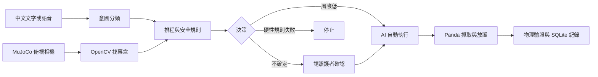
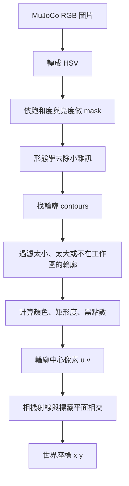
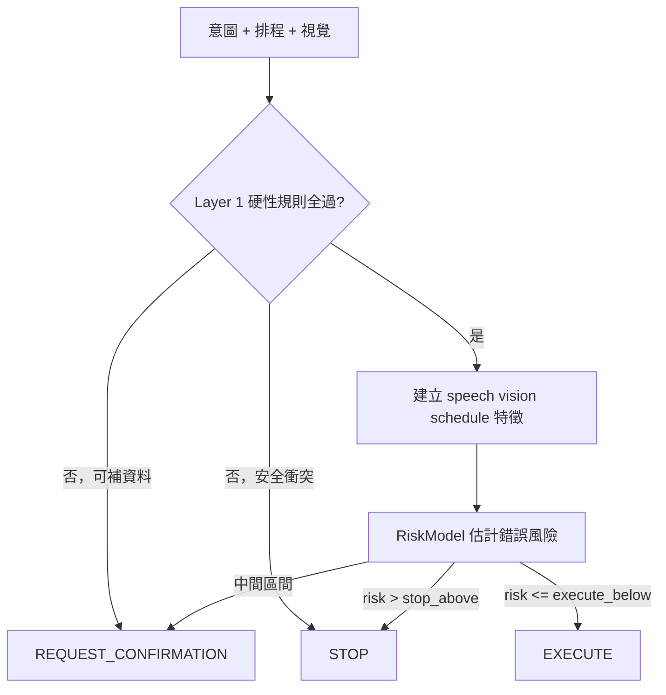

# CareArm AI 完全初學者講義

這份講義假設你沒有學過 Python、AI、機械手臂、MuJoCo、FastAPI 或 React。目標不是只讓你複製指令，而是讓你最後能回答：資料從哪裡來、每個模組做什麼、為什麼系統決定執行或停止，以及要如何自己重新做出最小版本。

> 安全界線：CareArm AI 是研究模擬，不是醫療器材，也不能拿來決定真實藥物或劑量。

## 1. 先用一句話理解專案

CareArm AI 會聽懂「幫我拿中午的藥」，用模擬器相機找出正確藥盒，檢查現在時間、今日是否已經拿過、盒子識別碼與不確定性，安全條件通過後才讓 Panda 機械手臂把盒子送到遞送區。



## 2. 現在專案實際完成到哪裡

已完成的部分：

- MuJoCo 裡的 Panda、三個開口藥杯、獨立藥丸、遞送區、回收區、俯視／側視／手腕相機。
- OpenCV 顏色標籤、黑點識別碼、像素到世界座標定位。
- 中文意圖分類、時段詞抽取、可選的 Faster-Whisper。
- 排程檢查、重複取藥阻擋、盒子身分與唯一性檢查。
- A/B/C/D 與 conformal E 五種策略、校正風險模型、信賴區間與配對統計檢定。
- Panda 閉迴路抓取、放置、回收，以及物理成功判定。
- FastAPI、React 儀表板、SQLite 事件紀錄、異常總部通報，以及 300 與 1200 情境研究結果。
- 送達後用 wrist RGB 影像比較藥丸是否未取、部分取走、全部取走或疑似掉落。

還不能宣稱的事情：

- 沒有在真實 Panda 或真實藥盒上驗證。
- 真實長者語音沒有納入量化實驗。
- 目前視覺背景與標籤仍比真實照護環境簡單。
- 風險模型的錯誤樣本很少，不能宣稱它比純安全規則更安全。
- wrist 目前只在 MuJoCo 影像驗證；不能把「藥丸離開杯子」說成「真人一定吞下」​​。
- 真人語音工具已完成，但還沒有真人錄音成績；策略 E 也還沒有正式 300／1200 情境數字。

## 3. 先認識你會看到的名詞

| 名詞 | 最簡單的意思 |
|---|---|
| Python | 把流程寫成程式的語言 |
| MuJoCo | 計算機械手臂、碰撞、摩擦與重力的物理模擬器 |
| Panda | Franka Panda 七軸機械手臂 |
| RGB 影像 | 每個像素由紅、綠、藍三個數字構成的圖片 |
| OpenCV | 處理圖片、輪廓與顏色的工具 |
| 意圖分類 | 判斷一句話是在要求早藥、中午藥、晚藥、取消或表示已吃完 |
| Confidence | 模型對自己答案的信心分數；不是百分之百保證 |
| Calibration | 讓模型分數更接近實際正確率 |
| Risk | 如果現在自動執行，發生錯誤的估計機率 |
| API | 網頁前端與 Python 後端交換資料的入口 |
| SQLite | 儲存在單一檔案中的資料庫 |
| Test | 自動檢查程式結果是否符合預期 |

## 4. 資料夾不是雜物：每層都有責任

```text
carearm-ai/
├── carearm/
│   ├── settings.py          讀設定、定義路徑與三個服藥時段
│   ├── pipeline.py          感知與語意處理的共用接線
│   ├── demo.py              最小的完整命令列示範
│   ├── simulation/scene.py  建立 MuJoCo 世界
│   ├── perception/          找藥盒，並比較 wrist 服藥前後影像
│   ├── speech/              把文字或語音變成意圖
│   ├── decision/            排程、安全規則與風險決策
│   ├── robot/executor.py    讓 Panda 執行取放
│   ├── database/store.py    寫入 SQLite
│   ├── api/                 提供網頁 API
│   └── experiments/         產生情境、比較策略與輸出指標
├── configs/default.yaml     可調整設定，不必先改 Python
├── frontend/                React 儀表板
├── models/                  已訓練模型與校正報告
├── results/                 實驗結果與資料庫
├── tests/                   自動化測試
├── README.md                快速安裝與操作
├── ARCHITECTURE.md          系統架構與安全邊界
├── RESEARCH.md              研究問題、假設與指標
├── EXPERIMENTS.md           如何重現實驗
├── HANDOFF.md               目前狀態與交接
└── CHANGELOG.md             每次真正做了什麼
```

## 5. 第一次執行：只做環境確認

打開 macOS Terminal，逐行執行：

```bash
cd /Users/chengchenyou/Desktop/ml/carearm-ai
source .venv/bin/activate
python --version
mjpython -m pytest -q tests
```

你應該知道每一行的意思：

1. `cd`：走進 CareArm 專案資料夾。
2. `source .venv/bin/activate`：啟用這個專案自己的 Python 工具箱。
3. `python --version`：確認現在用的是 Python 3.12。
4. `mjpython -m pytest`：在 macOS 用能建立 MuJoCo CGL 的 Python 跑完整測試；`-q` 代表精簡輸出。目前實際結果是 88 passed。

若看到 `invalid CoreGraphics connection`，代表執行環境拿不到 macOS 圖形連線；先確認你是在一般 Terminal，而不是無桌面的遠端程序。

## 6. 第一次看見 Panda 動起來

macOS 開 MuJoCo 視窗必須使用 `mjpython`：

```bash
cd /Users/chengchenyou/Desktop/ml/carearm-ai
source .venv/bin/activate
mjpython -m carearm.demo --period noon --viewer --confirm
```

這條命令拆開看：

- `mjpython`：可在 macOS 開 MuJoCo 視窗的 Python 啟動器。
- `-m carearm.demo`：執行 `carearm/demo.py`。
- `--period noon`：直接指定中午藥盒。
- `--viewer`：開啟 3D 視窗。
- `--confirm`：如果風險層要求照護者確認，就同意執行；硬性安全限制仍不能被覆蓋。

## 7. 第一次打開完整儀表板

```bash
cd /Users/chengchenyou/Desktop/ml/carearm-ai
./start.sh
```

等待後打開 `http://127.0.0.1:8000`。第一次先不要碰所有選項，只做這個練習：

1. 在文字框輸入「幫我拿中午的藥」。
2. 把模擬時間設成 12:10。
3. 先按分析，觀察意圖、視覺、排程、安全規則與風險。
4. 只有決策允許時才執行。
5. 查看最近一次執行的抬升高度與放置誤差。
6. 到事件紀錄確認每一步都有留下資料。

## 8. 系統真正執行一個指令的順序

以「幫我拿中午的藥」為例：

1. `IntentClassifier` 判斷這是 `SPECIFY_NOON`。
2. `MedicationSchedule` 檢查 12:10 是否在中午時段。
3. Panda 先移出俯視相機中央。
4. MuJoCo renderer 產生 RGB 圖片。
5. `LabelDetector` 用 HSV 顏色、輪廓與黑點數找藥盒。
6. 相機射線與標籤平面相交，得到世界座標 `(x, y)`。
7. Layer 1 檢查：是否真的要求取藥、是否重複、是否找到目標、識別碼是否相符、是否只有一個目標。
8. Layer 1 全過後，Layer 2 才估計執行風險。
9. 決策結果只能是 `EXECUTE`、`REQUEST_CONFIRMATION` 或 `STOP`。
10. 允許執行時，`RetrievalExecutor` 呼叫 Panda 閉迴路控制器。
11. 系統檢查物體是否抬高超過 8 公分、是否進入遞送區、是否撞動其他盒子。
12. 分析、決策、執行結果寫入 SQLite，前端再把它顯示出來。

## 9. 如果從零重做，正確順序是什麼

不要一開始同時做 AI、語音、網頁與機械手臂。依照以下順序，每一步都先寫測試：

### 階段 A：固定座標物理動作

- 只建立 Panda、一個盒子與一個目標區。
- 手動提供物體與目標座標。
- 完成 Home → Approach → Grasp → Lift → Place → Home。
- 用物體 sensor 驗證結果，不用「看起來有動」當作成功。

### 階段 B：模擬器相機

- 加入俯視相機。
- 只存一張 RGB 圖，先確認解析度與方向。
- 用 OpenCV 找顏色與輪廓。
- 做像素座標到世界座標轉換。

### 階段 C：語意與排程

- 先用文字，不急著接麥克風。
- 把句子分類成早／中／晚／取消／已服藥。
- 寫清楚三個服藥時段與重複取藥規則。

### 階段 D：安全決策

- 先寫不能被覆蓋的硬性規則。
- 再加入 confidence 與 risk。
- 把「請求確認」和「停止」分開。

### 階段 E：整合與紀錄

- 把感知、決策、Panda 執行接起來。
- 每個輸入、決策理由與結果都寫入資料庫。
- 最後才做 FastAPI 與 React 儀表板。

### 階段 F：研究實驗

- 先寫研究問題與假設。
- 分開 train、calibration、test。
- 用相同情境比較 A/B/C/D 策略。
- 報告失敗案例與限制，不能只報最好看的準確率。

## 10. 建議的十二堂課

1. Terminal、路徑、虛擬環境與 Python 模組。
2. 變數、函式、條件、迴圈、類別與 dataclass。
3. 讀懂 `configs/default.yaml` 與 `settings.py`。
4. MuJoCo 世界、body、geom、joint、sensor。
5. Panda 的 TCP、夾爪與閉迴路移動。
6. RGB、HSV、輪廓、外接框與相機座標。
7. 意圖分類、特徵、機率與校正。
8. 排程與 Layer 1 硬性安全規則。
9. Logistic Regression 風險模型與 Layer 2。
10. FastAPI、HTTP、JSON 與 SQLite。
11. React 儀表板如何呼叫 API。
12. 實驗切分、指標、失敗案例與研究報告。

每堂課都應該有四部分：先用白話解釋、看 CareArm 真實程式、親手改一個小地方、最後跑測試確認。

## 11. 第一堂課：先看懂最小 Python 接線

打開 `carearm/pipeline.py`，先讀這三個函式：

- `perceive(...)`：把模擬環境變成「影像 + 偵測結果」。
- `interpret(...)`：把「文字 + 時間」變成「意圖 + 排程檢查」。
- `observation_to_dict(...)`：把 Python 物件轉成容易儲存的字典。

先記住一個閱讀公式：

```text
函式名稱（輸入） → 函式裡做的步驟 → return 的輸出
```

例如：

```python
def interpret(text, minute, taken_today, clf, cfg):
    intent = clf.predict(text)
    schedule = MedicationSchedule.from_config(cfg, taken_today)
    return intent, schedule.check(minute, intent.period)
```

逐行白話：

1. `def interpret(...)`：建立一個叫 interpret 的可重複流程。
2. `text` 是使用者說的文字；`minute` 是現在時間換成一天中的第幾分鐘。
3. `clf.predict(text)`：請意圖分類器判斷文字。
4. `MedicationSchedule.from_config(...)`：根據設定檔與今日紀錄建立排程檢查器。
5. `return`：把意圖結果與排程結果一起交回呼叫者。

你的第一個練習不是改 AI，而是回答：這個函式有哪些輸入？輸出有幾個？它有沒有控制機械手臂？答案是：五個輸入、兩個輸出、沒有控制手臂。

## 12. 先補齊 Python：用 CareArm 的例子學語法

這一章不是要你一次背完 Python。每次看到陌生語法，先問三件事：

1. 這一行建立了什麼資料？
2. 這一行呼叫了哪個函式？
3. 執行完後，哪個變數改變了？

### 12.1 變數：替資料貼名字

```python
text = "幫我拿中午的藥"
minute = 12 * 60
confidence = 0.92
viewer = True
target = None
```

逐行看：

- `text` 是字串，也就是文字。
- `minute` 是整數；`12 * 60` 會算成 720，代表午夜後第 720 分鐘。
- `confidence` 是浮點數，也就是有小數點的數字。
- `viewer` 是布林值，只能是 `True` 或 `False`。
- `None` 代表「目前沒有值」，不是數字 0，也不是空字串。

你可以在 Terminal 親手試：

```bash
cd /Users/chengchenyou/Desktop/ml/carearm-ai
source .venv/bin/activate
python
```

看到 `>>>` 後輸入：

```python
minute = 12 * 60 + 10
print(minute)
```

預期得到 `730`。離開互動模式可輸入 `exit()`。

### 12.2 list、tuple、set、dict 到底差在哪裡

```python
periods = ["morning", "noon", "evening"]
world_xy = (0.50, 0.00)
taken_today = {"morning"}
scores = {"morning": 0.02, "noon": 0.96, "evening": 0.02}
```

| 寫法 | 中文 | CareArm 用途 | 特性 |
|---|---|---|---|
| `[...]` | list 清單 | 多個偵測結果 | 有順序，可以增減 |
| `(...)` | tuple 固定組 | `(x, y)` 座標 | 通常不修改 |
| `{...}` | set 集合 | 今天已取過哪些時段 | 不重複，查找很快 |
| `{"key": value}` | dict 字典 | 信心分數、設定檔 | 用名稱找值 |

例子：

```python
best_period = max(scores, key=scores.get)
print(best_period)          # noon
print(scores["noon"])     # 0.96
```

`max(..., key=scores.get)` 不是找英文最長的項目，而是用每個項目對應的分數比較。

### 12.3 if：讓程式做選擇

```python
if confidence >= 0.80:
    decision = "EXECUTE"
else:
    decision = "REQUEST_CONFIRMATION"
```

冒號 `:` 表示「下面開始是一個區塊」。前面的四個空白非常重要，它告訴 Python 哪些行屬於 `if`。不過 CareArm 真正的 D 策略不是只看單一 confidence；它先跑硬性規則，再看校正後 risk。上面只是學語法的縮小例子。

### 12.4 for：同一件事對每個物件做一次

```python
for period in ["morning", "noon", "evening"]:
    print(period)
```

CareArm 會用類似方式逐一檢查每個偵測到的標籤。`period` 每一輪會依序變成 `morning`、`noon`、`evening`。

### 12.5 函式：把步驟包成可重複使用的工具

```python
def to_minutes(hhmm: str) -> int:
    h, m = hhmm.split(":")
    return int(h) * 60 + int(m)
```

這是 `carearm/decision/schedule.py` 的真實程式：

1. `hhmm: str` 表示預期收到字串；這是提示，不是新的變數。
2. `-> int` 表示預期回傳整數。
3. `"12:10".split(":")` 會變成 `['12', '10']`。
4. `h, m = ...` 把兩項分別放進 `h` 和 `m`。
5. `int(h)` 把文字 `'12'` 轉成數字 `12`。
6. 最後回傳 `12 * 60 + 10 = 730`。

### 12.6 class 與 dataclass：替一整組資料定義格式

```python
@dataclass
class ExecutionResult:
    requested_period: str
    grasp_success: bool = False
    success: bool = False
```

把它想成一張空白表格的格式。建立物件時：

```python
result = ExecutionResult(requested_period="noon")
```

此時 `result.requested_period` 是 `"noon"`，而兩個成功欄位先是 `False`。執行器做完物理驗證後才會更新它們。

### 12.7 import：借用其他檔案的工具

```python
from carearm.decision.schedule import MedicationSchedule
```

意思不是複製檔案，而是讓目前程式可以使用 `schedule.py` 裡的 `MedicationSchedule`。從專案根目錄用 `python -m ...` 執行，可以讓 Python 正確找到 `carearm` 套件。

### 小練習

先自己回答，再看括號中的答案：

1. `world_xy = (0.50, 0.00)` 有幾個值？（2 個）
2. `taken_today = {"noon"}` 是不是 dict？（不是，是 set，因為沒有 `key: value`）
3. `return` 後面的資料交給誰？（呼叫這個函式的程式）
4. `confidence = 0.92` 是否代表保證 92% 正確？（不是，它是模型分數，還要看校正與測試結果）

## 13. YAML 設定檔：不用改程式也能調整場景

`configs/default.yaml` 是容易讓人閱讀的設定檔。Python 會讀取它，再建立場景與規則。

```yaml
schedule:
  morning: ["06:00", "10:00"]
  noon: ["11:00", "14:00"]
  evening: ["17:00", "21:00"]
```

白話意思：

- `schedule:` 是大分類。
- 縮排的 `morning`、`noon`、`evening` 是三個子項目。
- 中午視窗是 11:00 開始、14:00 結束；程式採「含開始、不含結束」，所以 13:59 算中午，14:00 不算。

再看一個真實物件設定：

```yaml
noon:
  box_id: "MED-NOON-02"
  label_name: "藍色"
  label_rgba: [0.15, 0.40, 0.95, 1.0]
  id_dots: 2
  default_position: [0.50, 0.00, 0.02]
```

- `box_id` 是研究場景中的盒子名稱。
- `label_rgba` 是紅、綠、藍、透明度，範圍 0 到 1。
- `id_dots: 2` 表示標籤上應看到兩個黑點。
- 位置單位是公尺，`z = 0.02` 表示盒子中心離桌面約 2 公分。

> 初學者常見錯誤：YAML 很重視縮排，而且不能混用 Tab。改完若讀取失敗，先檢查冒號、括號和縮排。

安全練習：不要直接改原檔。先複製設定概念到紙上，試算把中午開始改成 11:30 後，11:15 的請求應該落在哪一種情況。真正修改前要先建立測試，避免不小心改變研究基準。

## 14. MuJoCo 世界：把模擬器想成一座小型攝影棚

生活比喻：

- `body` 像演員的身體或一件道具。
- `geom` 像道具的外殼，負責外觀與碰撞。
- `joint` 像門鉸鏈，規定物體能怎麼動。
- `actuator` 像肌肉或馬達，對 joint 施力。
- `sensor` 像尺或回報器，讀出位置與狀態。
- `camera` 像架在棚頂的攝影機。

一個模擬步驟可以簡化成：

```text
控制器給動作 → MuJoCo 計算力與碰撞 → 更新位置 → sensor 回報 → 控制器再修正
```

這就是「閉迴路」：程式不是只說一次「去那裡」就不管，而是不斷看目前位置、計算剩餘誤差、再送下一個小動作。

CareArm 有兩種不同座標，不能混在一起：

| 座標 | 例子 | 單位 | 用途 |
|---|---|---|---|
| 像素座標 | `(u=318, v=205)` | pixel | 圖片上的點 |
| 世界座標 | `(x=0.50, y=0.00)` | meter | 桌面與機械手臂的位置 |

如果把像素當公尺送給手臂，數值會大到完全離開工作空間。因此相機模組一定要做「像素到世界」轉換。

## 15. 相機辨識：一張圖片如何變成抓取座標

真實入口在 `carearm/perception/detector.py` 的 `LabelDetector.detect_all()`。



### 15.1 為什麼先轉 HSV

RGB 把顏色拆成紅、綠、藍；HSV 則拆成：

- Hue：顏色種類，例如藍或紫。
- Saturation：顏色有多鮮豔。
- Value：有多亮。

CareArm 用 `MIN_SATURATION` 和 `MIN_VALUE` 排除太灰或太暗的區域，再找候選輪廓。

### 15.2 一個偵測結果長什麼樣

以下是教學用示意值，實際數字會隨場景改變：

```python
LabelDetection(
    bbox=(280, 190, 70, 42),
    center_px=(315.0, 211.0),
    world_xy=(0.50, 0.00),
    area_ratio=0.98,
    rectangularity=0.95,
    dot_count=2,
    predicted_period="noon",
)
```

- `bbox` 是畫在圖片上的方框 `(左上 x, 左上 y, 寬, 高)`。
- `center_px` 是方框中心的像素位置。
- `world_xy` 才是送給機械手臂的桌面座標。
- `area_ratio` 太低可能代表遮擋。
- `rectangularity` 越接近 1，輪廓越像完整矩形。
- `dot_count=2` 應對應中午盒 `MED-NOON-02`。

### 15.3 像素怎麼轉世界座標

`PixelToWorld` 做三件事：

1. 從相機位置穿過圖片上的 `(u, v)` 畫出一條 3D 射線。
2. 已知標籤頂面高度 `z = 0.0422 m`。
3. 求射線與這個水平面的交點，取出交點的 `(x, y)`。

這裡只用相機幾何與已知平面，不讀取 MuJoCo 物件的真實位置來作弊。模擬器真實位置只在最後驗證成功與否時使用。

> 不要混淆：`confidence` 是分類的信心；`area_ratio` 是看見多少面積；`world_xy` 是位置。三者回答的是不同問題。

## 16. 三個完整案例：跟著資料走一次

### 案例 A：12:00 明確要求中午藥

輸入：

```text
文字：幫我拿中午的藥
時間：12:00
今天已取：空集合
相機：看見早、中、晚三盒，中午盒是藍色且有 2 點
```

資料流：

| 階段 | 可能的主要結果 | 意思 |
|---|---|---|
| 意圖 | `SPECIFY_NOON`, period=`noon` | 使用者明確指定中午 |
| 排程 | target=`noon`, conflict=`False` | 12:00 符合中午候選時段 |
| 視覺 | predicted=`noon`, dots=`2` | 顏色與盒子識別碼相符 |
| Layer 1 | 全部通過 | 沒重複、目標存在且唯一 |
| Layer 2 | 依模型風險判斷 | 可能執行或要求確認 |
| 執行 | Pick → delivery | 最後仍需物理驗證 |

現有測試 `test_rule_based_executes_clean_case` 證明規則式策略對這個乾淨案例回傳 `EXECUTE`。

### 案例 B：08:00 卻要求晚上藥

輸入：

```text
文字：幫我拿晚上的藥
時間：08:00
```

排程會得到 `conflict=True`、`target=None`。Layer 1 的 `schedule_consistency` 失敗，因此決策是 `STOP`。就算風險模型聲稱風險接近 0，也不能推翻這條硬性限制。

這是為什麼專案不使用「只要 AI 很有信心就執行」：AI 可能很確定自己看見晚藥盒，但現在時間仍與請求衝突。

### 案例 C：10:40 只說「我要吃藥」

早上視窗剛結束不久，中午視窗也快開始。因為程式保留早晚寬限時間，`plausible` 同時包含 `morning` 和 `noon`。

```text
candidate = None
needs_clarification = True
decision = REQUEST_CONFIRMATION
```

這時照護者需要先說明是哪一個時段。由於沒有唯一目標座標，不能只是按確認就硬抓某一盒。這和「目標已明確，但模型風險中等」的人工確認不同。

### 案例 D：12:00 再次要求已取過的中午藥

```python
taken_today = {"noon"}
```

`duplicate_retrieval` 會失敗，決策是 `STOP`。人工確認也不能覆蓋硬性安全限制。若是研究介面資料有誤，應先修正「今日紀錄」，而不是強迫執行。

## 17. 決策層：先踩煞車，再討論風險



Layer 1 會檢查：

- 使用者是否真的要求取藥。
- 指定時段是否和現在時間一致。
- 今天是否已經取過。
- 是否看得到目標盒。
- 顏色與黑點識別碼是否相符。
- 目標是否唯一。

Layer 2 用到三群特徵：

- 語音：意圖信心、第一二名差距、關鍵字是否一致、未知字比例。
- 視覺：顏色信心、第一二名差距、面積、矩形度、亮度、候選數。
- 排程：距視窗中心多遠、是否明確指定、合理候選有幾個。

`risk=0.20` 的意思是模型估計「執行可能出錯的風險」，不是成功率 20%，也不是醫療風險。門檻由校正資料決定，而且目前錯誤樣本少，所以不可過度解讀。

## 18. Panda 如何完成一次抓取

真實流程在 `carearm/robot/executor.py`：

```text
張開夾爪
→ 移到藥盒上方（travel height）
→ 降到 approach height
→ 降到 grasp height
→ 閉合夾爪
→ 抬到 travel height
→ 驗證是否有且只有一盒抬高超過 8 cm
→ 移到遞送區上方
→ 下降、張開、等待物體穩定
→ 垂直退出
→ 回到安全姿態
```

為什麼不直接斜線衝向盒子？因為斜著移動可能撞到桌面或旁邊物體。先升高、平移、再下降，是比較容易理解與驗證的 waypoint 流程。

執行成功不等於動畫播放完。`ExecutionResult.success` 必須同時滿足：

1. 剛好一個盒子被抬高超過 8 公分。
2. 那一盒最後新進入目標區。
3. 它就是要求的時段。
4. 其他盒子沒有移動超過 1.5 公分。

教學用結果示例：

```json
{
  "requested_period": "noon",
  "lifted_box": "noon",
  "delivered_box": "noon",
  "grasp_success": true,
  "placed_in_delivery": true,
  "other_boxes_disturbed": false,
  "success": true
}
```

實際結果可能不同；這段 JSON 是幫你看懂欄位，不是聲稱每次都會成功。

## 19. 網頁、API 與資料庫：三個角色怎麼合作

把它想成餐廳：

- React 前端是服務生：收集使用者輸入、展示結果。
- FastAPI 是櫃台：檢查點單格式、把工作交給模擬服務。
- `SimulationService` 是廚房：真正跑感知、決策與機械手臂。
- SQLite 是工作日誌：記錄發生過什麼事。

### 19.1 一個 API 請求範例

前端送出：

```http
POST /api/command
Content-Type: application/json
```

```json
{
  "text": "幫我拿中午的藥",
  "time": "12:00",
  "source": "text"
}
```

`CommandBody` 會檢查欄位。空字串會得到 HTTP 400，而不是讓後面的 AI 猜。分析結果會包含 `intent`、`schedule`、`detections`、`decision`、`timing_ms` 等欄位。

分析和執行刻意分成兩個 API：

```text
POST /api/command  → 只分析，讓人先看理由
POST /api/execute  → 通過規則後才真的讓手臂動
```

如果決策要求人工確認，第二個請求要帶：

```json
{"caregiver_confirmed": true}
```

但程式仍會再次檢查硬性規則；人工確認不是解除所有安全鎖。

### 19.2 SQLite 記了什麼

`carearm/database/store.py` 建立：

- `runs`：一次研究實驗。
- `scenarios`：每個情境的輸入。
- `decisions`：不同策略的決定。
- `executions`：物理執行結果。
- `events`：操作台上的逐步事件。

這讓研究結果可以追溯。若畫面顯示「成功」，仍能回頭查當時輸入、決策理由與物理結果，而不是只相信畫面上的綠色文字。

## 20. 看懂測試：先讀 Arrange、Act、Assert

以 `tests/test_schedule.py` 的概念為例：

```python
def test_explicit_conflict(cfg):
    c = MedicationSchedule.from_config(cfg).check(
        to_minutes("08:00"), "evening"
    )
    assert c.conflict and c.target is None
```

拆成三段：

1. Arrange：`cfg` 提供設定，準備 08:00 和 evening。
2. Act：呼叫 `check(...)`。
3. Assert：確認真的衝突，而且沒有可執行目標。

`assert` 失敗時，pytest 會顯示哪個條件不是預期值。請從錯誤最下方的專案檔案與行號往上讀，不要從數百行 traceback 的第一行開始慌張。

### 20.1 建議測試順序

先跑單一檔案：

```bash
.venv/bin/python -m pytest -q tests/test_schedule.py
```

再跑不需要圖形 renderer 的核心測試：

```bash
.venv/bin/python -m pytest -q \
  tests/test_database.py \
  tests/test_decision.py \
  tests/test_intent.py \
  tests/test_schedule.py
```

最後在一般 macOS Terminal 跑全部：

```bash
.venv/bin/python -m pytest -q tests
```

### 20.2 pass、fail、error 不一樣

- `passed`：測試完成且答案正確。
- `failed`：測試有跑完，但 assert 不符合。
- `error`：測試還沒走到 assert 就出錯，例如 renderer 無法建立。
- `skipped`：測試因條件不符而被跳過。

因此 `invalid CoreGraphics connection` 是圖形環境建立失敗，不能解讀成辨識答案錯誤，也不能算作完整測試通過。

## 21. 從零做一個縮小版：六個可以驗收的小作品

每一步都只新增一種能力。完成標準寫在右邊；沒通過就不要急著進下一步。

| 小作品 | 你要做什麼 | 可以驗收的證據 |
|---|---|---|
| 1. 時間轉換器 | 寫 `to_minutes` | 12:10 得 730，錯誤格式有明確錯誤 |
| 2. 排程判斷器 | 依時間找早／中／晚 | 乾淨、衝突、模糊、重複都有測試 |
| 3. 固定座標取放 | 不用相機，只給 `(x,y)` | sensor 證明盒子抬起並進入目標區 |
| 4. 相機定位 | RGB 找方框並轉世界座標 | 與驗證位置比較誤差 |
| 5. 安全決策 | 接上意圖、排程、視覺 | 硬性衝突一定不能執行 |
| 6. 完整服務 | FastAPI + 前端 + SQLite | 一筆請求能追到分析、執行與事件 |

最小主程式可以先用偽程式碼理解：

```python
text = get_user_text()
image = camera.capture()

intent = understand(text)
detections = detect_boxes(image)
schedule = check_schedule(now(), intent)
decision = decide(intent, detections, schedule)

if decision == "EXECUTE":
    result = robot.pick_and_place(decision.target_xy)
elif decision == "REQUEST_CONFIRMATION":
    ask_caregiver()
else:
    stop_and_explain()

save_everything_to_database()
```

這不是 CareArm 可直接執行的原始碼，而是一張「主流程地圖」。讀真實專案時，逐行把偽程式碼對應到 `pipeline.py`、`decision/engine.py`、`robot/executor.py` 和 `api/service.py`。

## 22. 初學者最常卡住的問題

### `ModuleNotFoundError: No module named carearm`

通常是沒有站在專案根目錄，或沒啟用 `.venv`：

```bash
cd /Users/chengchenyou/Desktop/ml/carearm-ai
source .venv/bin/activate
python -m carearm.demo --period noon
```

### `launch_passive requires mjpython`

只要要開 macOS MuJoCo 原生視窗，就用：

```bash
mjpython -m carearm.demo --period noon --viewer --confirm
```

不要用普通 `python ... --viewer`。

### `invalid CoreGraphics connection`

這代表目前程序拿不到 macOS 圖形連線。請改在一般 Terminal 執行；不要因為這個 error 去亂改辨識或決策程式。

### 網頁打得開，但 Panda 沒動

依序檢查：

1. 是否先按了分析。
2. decision 是 `EXECUTE`、`REQUEST_CONFIRMATION` 還是 `STOP`。
3. 若要確認，目標是否已明確且硬性規則全過。
4. `/api/status` 是否顯示 `busy=true`。
5. 事件紀錄最後一筆是 decision、robot 還是 error。

### 信心很高，為什麼還是停止

因為硬性安全規則優先。時段衝突、重複取藥、錯盒識別碼或多個相同目標都不能被高信心覆蓋。

### 畫面看起來放到了，為什麼結果是失敗

系統看的是物理條件：盒子是否新進入目標區、是否是正確盒、其他盒子是否被撞動。肉眼覺得「差不多」不等於驗證通過。

## 23. 建議閱讀順序：一次只追一條資料

第一輪只追「時間」：

```text
API 的 time → to_minutes → ScheduleCheck → hard_constraints → decision
```

第二輪只追「位置」：

```text
RGB → contour → center_px → PixelToWorld → world_xy → target_xy → executor
```

第三輪只追「結果」：

```text
盒子 sensor → ExecutionResult → service state → SQLite event → 前端畫面
```

推薦檔案順序：

1. `configs/default.yaml`
2. `carearm/decision/schedule.py`
3. `tests/test_schedule.py`
4. `carearm/pipeline.py`
5. `carearm/perception/detector.py`
6. `carearm/decision/engine.py`
7. `tests/test_decision.py`
8. `carearm/robot/executor.py`
9. `carearm/api/service.py`
10. `carearm/api/app.py`
11. `carearm/database/store.py`

每讀一個函式，就寫下「輸入、步驟、輸出、副作用」四格筆記。副作用是指函式除了回傳值之外，是否還會移動手臂、改狀態、寫資料庫或存檔。

## 24. 你是否真的理解：自我檢查題

1. 為什麼相機拍照前要把 Panda 移到觀測姿態？
2. `center_px` 和 `world_xy` 哪一個能給機械手臂？
3. 為什麼兩個外觀相同的目標應停止？
4. 為什麼人工確認不能覆蓋所有規則？
5. `grasp_success=True` 是否已代表完整成功？
6. 為什麼分析 API 和執行 API 要分開？
7. 測試出現 renderer error，能不能說決策邏輯測試失敗？

參考答案：

1. 避免手臂擋住俯視相機。
2. `world_xy`；前者只是圖片位置。
3. 系統無法證明要抓哪一個，目標不唯一。
4. 人也不能把已知的時段衝突、重複或錯盒當作不存在。
5. 不是；還要正確放入目標區、盒子身分正確且沒撞動其他盒。
6. 讓使用者先看見辨識、規則和理由，再產生物理動作。
7. 不能；那是測試環境 setup error，要分開判讀。

## 25. 每次修改後固定要做的事

1. 跑與修改相關的最小測試。
2. 再跑完整測試。
3. 說明哪些測試在目前環境不能完成。
4. 更新 `CHANGELOG.md`。
5. 更新 `HANDOFF.md` 的狀態、限制與下一步。
6. 不把模擬結果說成真實醫療或真實機器人驗證。

## 26. 開口藥杯與藥丸：為什麼不是畫一張貼圖就好

藥丸必須是「獨立剛體」，否則你只是在盒子圖片上畫圓點，機械手臂搬動、使用者取走或掉落時都不會有真正物理變化。

`scene.py` 的概念可以拆成三層：

```python
body = spec.worldbody.add_body(name="noon_pill0")
body.add_freejoint(name="noon_pill0_joint")
body.add_geom(type=mujoco.mjtGeom.mjGEOM_SPHERE, mass=0.0006)
```

逐行看：

1. `add_body`：在世界中建立一顆藥丸的「物體容器」。
2. `add_freejoint`：允許它有自己的 X、Y、Z 位置和旋轉，不會黏死在桌上。
3. `add_geom`：給它球形外觀、碰撞形狀和質量，MuJoCo 才能算重力與接觸。

藥杯本身用底板、四面牆與中央橋組成。中央橋頂面仍放顏色標籤與黑點，所以藥丸不會蓋住盒子識別資訊。每次 reset 時，`_place_pills` 把藥丸的「盒內相對座標」旋轉、平移成世界座標。

請分清兩種資料：

- `pills_in_box()`：讀模擬器真實座標，只能拿來測試答案是否正確。
- wrist RGB：正式判讀用的感測器影像，不知道 MuJoCo 的答案。

這叫做避免 ground-truth leakage（答案洩漏）。如果 AI 一邊考試一邊偷看標準答案，測試分數再高也沒有研究價值。

## 27. 手腕相機服藥驗證：從兩張圖片得到結果

完整流程是：

```text
藥盒送達
→ Panda 把 handcam_rgb 移到藥杯上方
→ 保存「服藥前」基準圖
→ 模擬使用者取藥
→ 再拍一張
→ 對齊兩張影像
→ 找出改變的像素與區域
→ 判斷未取、部分、完成或疑似掉落
```

最重要的物件是：

```python
monitor = WristComplianceMonitor(cfg["compliance"])
monitor.start("noon", before_rgb, expected_count=2)
result, annotated = monitor.evaluate("noon", after_rgb)
```

逐行解釋：

1. 第一行依 YAML 門檻建立影像判讀器。
2. 第二行記住中午藥杯的基準圖，以及裝盒計畫預期 2 顆。這個數字是「計畫資料」，不是偷偷讀目前藥丸座標。
3. 第三行比較新圖，`result` 是數字與狀態，`annotated` 是畫出判讀框的圖。

### 27.1 為什麼要先對齊影像

機械手臂移到同一個座標，不代表每次影像都完全落在同一個像素。只差幾毫米，杯緣就會在差分圖變成一大圈亮線。

程式使用 `cv2.findTransformECC` 找一個小型仿射轉換，把目前影像對齊基準影像。仿射轉換可修正平移、旋轉和少量縮放。若相機根本沒離開檢查姿態，就不重走路徑，減少新的誤差。

### 27.2 狀態不是只有 true / false

| 狀態 | 白話意思 | 系統行為 |
|---|---|---|
| `WAITING` | 已建立基準，還沒再次檢查 | 等待 |
| `NOT_TAKEN` | 杯內沒有明顯改變 | 顯示尚未取藥 |
| `PARTIAL` | 只看到部分藥丸消失 | 顯示並通報 |
| `TAKEN` | 預期數量都有消失證據 | 顯示完成 |
| `POSSIBLE_DROP` | 杯內消失，杯旁又出現變化 | 要人工確認並通報 |

這裡的 `confidence` 是影像差異證據強度，不是醫療上的「服藥成功率」。

### 27.3 「藥送到了」不等於「已服用」

這是這次特別修正的重要觀念。程式用兩個 `set` 分開記錄：

```python
self.retrieved_today: set[str] = set()
self.taken_today: set[str] = set()
```

逐行看：

1. `self` 代表目前這一個後端服務物件。
2. `retrieved_today` 保存今天已經送達的時段，例如 `{"noon"}`。它的用途是防止使用者又拿一次中午藥。
3. `taken_today` 保存已被影像或人工確認的時段。它才會增加儀表板的「今日服藥」數字。
4. `set[str]` 表示這是一組不重複的字串；同一個 `"noon"` 加兩次仍只會有一份。

送藥成功時只做：

```python
self.retrieved_today.add(period)
```

意思是「這個時段已領藥」，不是「人已吞下藥」。之後 wrist 影像判讀為 `TAKEN`，才做：

```python
self.taken_today.add(period)
```

所以畫面上的正確順序是：

```text
送達前：未服用、未送達
送達後：已送達，但今日服藥仍是 0/3
wrist 確認全部取走後：已服用，今日服藥變成 1/3
```

重複取藥檢查則要同時看兩組資料：

```python
already_handled = self.retrieved_today | self.taken_today
```

中間的 `|` 是集合聯集，白話是「在左邊或右邊出現過都算」。這樣既不會把送達誤報成已服用，也不會因為還沒確認吞服就允許重複拿同一時段的藥。

最後還要記住：這套模擬只能確認「預期藥丸已從杯中消失」，不能證明真人真的吞下去。介面用「已服用」是流程狀態，研究報告仍應清楚寫出這個限制。

## 28. 異常通報：辨識、保存、送出是三件不同的事

`carearm/safety/alerts.py` 做三層工作：

1. `detect_alerts(text)`：透明關鍵字規則，例如胸痛、呼吸困難、跌倒、額外劑量。
2. `AlertCenter.raise_alert(...)`：把事件保存到 SQLite。
3. `_deliver(...)`：送進內建總部收件匣，或以 JSON POST 傳到設定的 webhook。

設定檔目前是：

```yaml
alerts:
  webhook_url: "local"
```

`local` 代表不傳到外部網路，只寫進本機模擬總部。若未來改成真正網址，才會產生對外 HTTP 請求；部署前必須另外處理身分驗證、加密、重試、權限與隱私，不能只把網址填上就當成醫療系統。

緊急關鍵字會停止取藥；一般不適會改成照護者確認；依從性異常則保留影像判讀訊息並通報。這三種嚴重度不能混成同一個按鈕。

## 29. Conformal、信賴區間與 McNemar：研究數字怎麼讀

### 29.1 Conformal 策略 E

一般門檻是「覺得 0.05 看起來合理」；conformal 會用 calibration split 的有限樣本公式選出最大安全門檻。資料分工是：

```text
train       → 訓練風險模型
calibration → 選 conformal 門檻
test        → 最後一次評分，不能回頭調參數
```

如果拿 test 選門檻，就像先偷看考題再宣稱成績很好。策略 E 仍先跑 Layer 1；時段衝突、重複取藥、錯盒和不唯一目標不會被 conformal 覆蓋。

### 29.2 Bootstrap 95% 信賴區間

單一 `39.2%` 只是一個樣本結果。Bootstrap 會以「情境」為單位重抽很多次，得到可能波動範圍。例如既有 exp1200 中，D 的正確取藥率點估計是 0.3917，95% CI 是 `[0.3389, 0.4417]`。這不是說真值有 95% 機率在裡面，而是這套重複抽樣程序長期會覆蓋真值約 95%。

### 29.3 McNemar 為什麼要配對

A、B、C、D 都跑同一批 scenario，不能當成互不相關的兩群。McNemar 只數：

- A 錯、D 對有幾件。
- A 對、D 錯有幾件。

兩邊差很多才表示策略在相同情境上有系統性差異。`p < 0.05` 不是「D 有 95% 機率比較好」，也不代表效果一定重要；要和差異件數、指標及信賴區間一起看。

## 30. 真人語音評估：先匿名，再談模型

錄音資料夾格式：

```text
data/voice/S001/V001_quiet.wav
data/voice/S001/V001_tv.wav
```

`S001` 是匿名代碼，不是姓名。`manifest.csv` 記 speaker_id、年齡組、性別、安靜／電視噪音、句子代碼和檔案路徑。正式錄音前先讀 `docs/voice_consent.md`。

評估四個數字：

- CER：轉錄字元錯多少。
- 意圖準確率：即使字不完全相同，系統是否仍懂對意思。
- ECE：信心分數是否可信。
- latency：每句平均要等多久。

沒有真人 WAV 時，只能用 `--fake-transcriber` 測流程，不能把 100% 當成 Whisper 成績。

## 31. 你現在怎麼完整操作一次

終端機：

```bash
cd /Users/chengchenyou/Desktop/ml/carearm-ai
source .venv/bin/activate
mjpython -m carearm.api.app --fast
```

瀏覽器開 `http://127.0.0.1:8000`，依序做：

1. 把時間設成 12:00。
2. 點「幫我拿中午的藥」。
3. 確認決策顯示執行、五條硬性規則通過。
4. 點「執行取藥」，等 Panda 完成九個階段。
5. 切到「手腕相機」，看到驗證卡為「等待服藥」、預期 2 顆。
6. 點「模擬取走 1 顆」，應顯示只取部分、估計 1 顆。
7. 點「模擬全部服用」，應顯示已取走預期藥丸、估計 2 顆。
8. 要測掉落，先重置並重新送一盒，再點「模擬掉落 1 顆」；應顯示疑似掉落並出現在通報頁。

最後跑：

```bash
mjpython -m pytest -q tests
cd frontend
npm run build
```

2026-10-24 實際驗證結果是 88 tests 全過，前端 production build 成功。若未來數字改變，以你當次終端機實際輸出為準，不要背這個數字。

